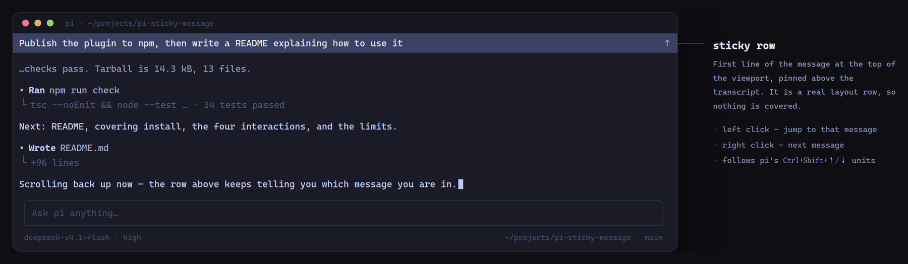

# pi-sticky-message

A sticky one-line header for the [Pi](https://pi.dev) coding agent's fullscreen transcript: it always shows the first line of the message you are currently reading, and clicking it jumps between messages.

Inspired by Codex's sticky message header. Built because scrolling up in a long Pi session leaves you without any idea which prompt or reply you are looking at.



The row sits above the transcript and shows the first line of the message you are currently reading. It hides when you scroll back to the top, and when you land on a message start by clicking it.

What makes this one different: it tracks **every** message — prompts, replies, and tool blocks alike — not just the last thing you typed, and it is a real layout row rather than an overlay. Nothing is drawn over the transcript, the viewport simply shrinks by one line, and no private Pi internals are patched, so scrollbar dragging and text selection keep working on their own and the row survives Pi upgrades.

## Install

```bash
pi install npm:pi-sticky-message
```

Or try it for a single run:

```bash
pi -e npm:pi-sticky-message
```

Restart Pi (or run `/reload`) after installing.

## Use

| Action | Result |
|---|---|
| Scroll up in the transcript | A row appears at the very top with the first line of the message at the top of the viewport |
| **Left click** the row | Align to that message's start; click again to walk to the previous message |
| **Right click** the row | Jump to the next message |
| Scroll back to the top | The row disappears |
| Click and land on a message start | The row hides while you stay parked there (the text is already on screen); any scroll brings it back |

The row is a real layout row, **not an overlay**: the transcript viewport shrinks by one line, so nothing is covered and scrollbar dragging, text selection, and mouse-wheel scrolling all keep working normally.

## Commands

```
/sticky-message                  toggle on/off
/sticky-message on | off         explicit toggle
/sticky-message contrast <0..1>  background brightness (0 = theme's selectedBg, default 0.25)
/sticky-message hint on | off    the faint ↑ hint on the right (default on)
/sticky-message pad <0..8>       left indent, to line up with transcript text (default 1)
/sticky-message reset            restore defaults
/sticky-message debug            print diagnostics and show a static test overlay
```

Configuration is persisted to `<agent-dir>/sticky-message.json` (usually `~/.pi/agent/sticky-message.json`) and applies immediately — no restart needed.

### Matching your `outputPad`

The row indents by `pad` columns (default `1`) so its text lines up with transcript text, which Pi indents by `outputPad` (default `1`). If you changed `outputPad` in `settings.json`, set the same value here:

```bash
/sticky-message pad 0
```

## Requirements and limitations

- **Fullscreen mode only** (`"tuiMode": "fullscreen"`, the default). In regular mode the terminal owns the scrollback, so there is no viewport to pin a row to.
- Jump targets are **message boundaries**, the same units Pi's own `Ctrl+Shift+↑/↓` uses (every user message and assistant reply starts a new one), not every individual tool call.
- The extension reads Pi runtime internals that have no public API (`TuiAltScreen.getMountedRoots()`, `ScrollView.scrollTop/scrollTo/children`, the layout root's `entries`). A Pi upgrade can break it; the usual failure mode is the row silently not appearing. Run `/sticky-message debug` and check the log it points at.
- One line is the whole point: long messages are ellipsized, not wrapped.

## How it works

1. A zero-height widget is registered with `ctx.ui.setWidget()` purely to obtain the current `TUI` instance.
2. The transcript is found by walking the mounted layout roots for the `primary` `ScrollView`.
3. Message boundaries come from Pi's own OSC 133 zone markers: the transcript document is rendered once, and every line starting with `\x1b]133;A` is a message start. Results are cached for 400 ms and invalidated by width.
4. The row component is unshifted into the layout root's `entries`, so the transcript viewport loses exactly one line while the row is visible and zero lines while it is hidden (`basis: "auto"`).

## Development

```bash
npm install
npm run check     # tsc --noEmit + node --test
```

Tests run on Node's native TypeScript stripping; no build step, and no compiled output is published — Pi loads `src/index.ts` directly through jiti.

The README preview is generated from [`assets/preview.html`](assets/preview.html):

```bash
chrome --headless=new --hide-scrollbars --force-device-scale-factor=2 \
  --window-size=1560,660 --screenshot=/tmp/shot.png assets/preview.html
magick /tmp/shot.png -fuzz 6% -trim +repage -bordercolor '#0f0f13' -border 40 \
  -resize 1800x assets/preview.png
```

## License

MIT
